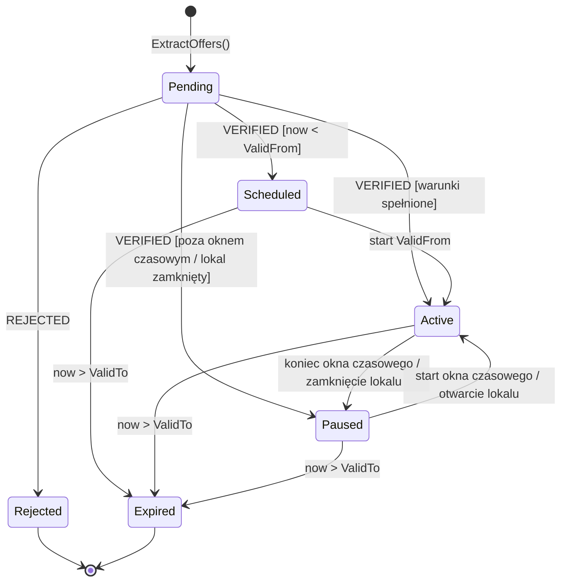

Trzy drogi po Pending: Po procesie akceptacji oferta od razu wpada tam, gdzie pasuje (np. do Paused, jeśli lokal jest akurat zamknięty).

Pętla Active «» Paused: Zniżka włącza się i wyłącza w kółko zależnie od godzin otwarcia lub pory lunchu, bez utraty ważności.

Wyjście do Expired z trzech miejsc: Gdy minie ValidTo, oferta wygasa zawsze — nieważne, czy była aktywna, wstrzymana, czy jeszcze nie ruszyła.

Dwa końce (Rejected, Expired): Jak oferta tu wpadnie, to koniec — nie da się jej już przywrócić.
