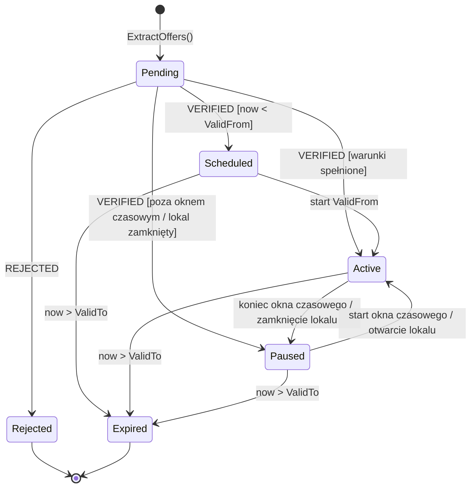

# Decyzje projektowe: Interaktywna Mapa Zniżek Studenckich
### Decyzja 1: Osobny stan `Scheduled` dla ofert, których okno ważności jeszcze się nie zaczęło

**Problem i alternatywy.** Zweryfikowana oferta może mieć `ValidFrom` w przyszłości, więc nie wolno jej jeszcze pokazywać na mapie. Rozważano pozostawienie jej w `Pending` do czasu startu, flagę `IsVerified` ze sprawdzaniem `ValidFrom` przy każdym zapytaniu oraz stan `Active` z filtrem czasowym. Pierwsze rozwiązanie nie odróżnia ofert zweryfikowanych od niezweryfikowanych. Drugie rozprasza logikę widoczności po zapytaniach. Trzecie sprawia, że `Active` przestaje znaczyć „oferta jest teraz dostępna".

**Rozwiązanie.** Wprowadzono jawny stan `Scheduled`. Przejście `Pending → Scheduled` następuje przy `VERIFIED [now < ValidFrom]`, a `Scheduled → Active` w chwili startu `ValidFrom`. Każdy stan ma jedno znaczenie biznesowe, a weryfikacja jest wykonywana raz, niezależnie od startu oferty.

**Konsekwencje.**

* Zapytanie o aktywne oferty to prosty filtr po stanie `Active`, a oferty nadchodzące łatwo wylistować.
* Potrzebny jest mechanizm (scheduler) wyzwalający `Scheduled → Active`, a jego opóźnienie oznacza spóźnione uaktywnienie oferty.
* Przybywa stanów i przejść do utrzymania i przetestowania, m.in. `Scheduled → Expired`, gdy oferta wygaśnie przed startem.

---

### Decyzja 2: Stan `Paused` jako odwracalna alternatywa dla `Expired`

**Problem i alternatywy.** Oferta może być ważna kalendarzowo, ale chwilowo niedostępna, bo obowiązuje tylko w określonych godzinach albo lokal jest zamknięty. Rozważano przejście do `Expired` poza oknem czasowym, wyliczanie dostępności w locie przy każdym zapytaniu oraz dwa pola: stan cyklu życia i flagę „chwilowo niedostępna". `Expired` jest stanem końcowym, więc powtarzalne okna wymagałyby tworzenia ofert od nowa. Wyliczanie w locie jest kosztowne i prowadzi do niespójnych wyników. Dwa pola tworzą kombinacje stanów, z których część jest niedozwolona.

**Rozwiązanie.** Wprowadzono stan `Paused` z przejściami `Active ⇄ Paused` (koniec i start okna czasowego, zamknięcie i otwarcie lokalu). Dodatkowo `Pending → Paused` obsługuje ofertę zweryfikowaną poza oknem czasowym. Z `Paused` zawsze można przejść do `Expired` po `ValidTo`, więc żadna oferta nie utknie w stanie wstrzymanym.

**Konsekwencje.**

* Jedna oferta obsługuje cały cykl życia wraz z powtarzalnymi oknami, bez duplikowania rekordów i bez utraty historii.
* Stan jest zmaterializowany, więc odczyt ofert dostępnych „teraz" jest szybki i spójny.
* Stan trzeba aktualizować zdarzeniowo lub cyklicznie, a błąd synchronizacji może pokazać ofertę przy zamkniętym lokalu.
* Równoczesne zdarzenia (np. koniec okna i `ValidTo`) wymagają jednoznacznego priorytetu, tu wygrywa `Expired`.
* Powrót do `Active` jest możliwy dopiero wtedy, gdy spełnione są jednocześnie okno czasowe i otwarcie lokalu.
